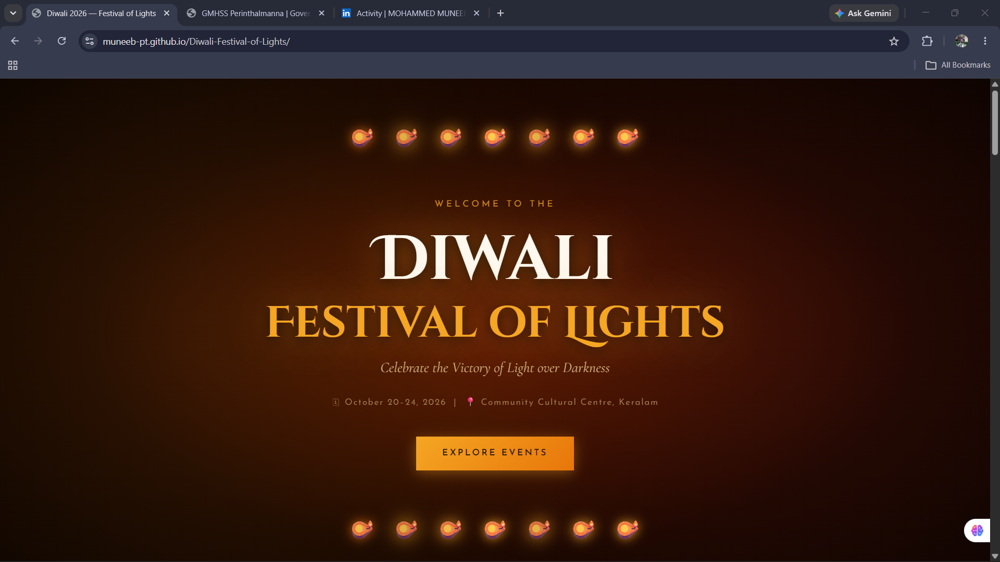

# 🪔 Diwali — Festival of Lights

*A vibrant, responsive Diwali-themed website developed as part of the Foundation of Computing course during my first year of B.Tech Computer Science and Engineering.*

\<p align="center">   \   \   \ \</p>

---

## ✨ Overview

**Diwali — Festival of Lights** is a static festival-themed website created as a first-year academic assignment for the **Foundation of Computing** course.

The website introduces the celebration of Diwali through a visually engaging interface, featuring information about the festival, celebrations, events, schedules, and a photo gallery.

The main objective was to apply fundamental HTML and CSS concepts while gaining practical experience in webpage structure, styling, responsive layouts, and publishing a website using GitHub Pages.

## 🌟 Features

- 🪔 Diwali-inspired visual theme
- 🎨 Custom HTML and CSS styling
- 📱 Responsive webpage layout
- 🧭 Navigation menu
- ✨ Festival-themed hero section
- 📖 About Diwali section
- 🎉 Events and celebrations
- 📅 Festival schedule
- 🖼️ Image gallery
- 🌐 Custom typography and visual elements
- 🚀 Hosted using GitHub Pages

## 🖥️ Live Demo

**Explore the website:**

[Diwali — Festival of Lights](https://muneeb-pt.github.io/Diwali-Festival-of-Lights/)

## 📸 Website Preview

Add a screenshot of the actual website to the repository at:

`assets/preview.png`

Then use the following Markdown:

```markdown

```

> The preview will appear here once the screenshot is added to the repository.

## 🛠️ Technologies Used

| Technology        | Purpose                                                  |
| ----------------- | -------------------------------------------------------- |
| HTML5             | Webpage structure and content                            |
| CSS3              | Styling, layouts, colors, typography, and responsiveness |
| Google Fonts      | Web typography                                           |
| Wikimedia Commons | External visual resources                                |
| Git               | Version control                                          |
| GitHub            | Repository hosting and website deployment                |

## 📂 Project Structure

```text
Diwali-Festival-of-Lights/
│
├── index.html       # Main webpage
├── style.css        # Website styling
├── README.md        # Project documentation
├── .gitignore       # Git ignored files
└── LICENSE          # License, if included
```

*An `assets/` directory can be added when storing the website preview or other local resources.*

## 🧩 Website Sections

### 🏠 Hero Section

Introduces the Diwali celebration through a prominent festival-themed design and call-to-action elements.

### 🪔 About Diwali

Provides an introduction to Diwali and its cultural significance.

### 🎊 Events & Celebrations

Highlights activities and experiences associated with the festival.

### 📅 Schedule

Presents a structured schedule of festival-related activities.

### 🖼️ Gallery

Displays selected visuals related to Diwali and its celebrations.

## 🎯 Learning Objectives

This project provided an opportunity to practise the fundamentals of frontend web development.

Key learning areas included:

- Understanding HTML document structure
- Using HTML elements to organize content
- Creating navigation sections
- Working with images and external resources
- Applying CSS selectors and styling rules
- Managing spacing, typography, and layouts
- Building visually consistent webpage sections
- Understanding basic responsive design
- Organizing files in a web project
- Using GitHub for version control and hosting

## 🤖 AI Assistance

AI tools were used as development assistance during this project, particularly to work within the available time.

Assistance included:

- Initial design and layout suggestions
- HTML and CSS code suggestions
- Debugging and troubleshooting
- Content refinement
- Improving visual presentation
- Understanding web-development concepts

Claude AI was used as an assistance tool during development. Its suggestions were incorporated into the project as part of the development process.

**AI assistance is acknowledged transparently; this project represents an early learning experience rather than an independently developed advanced application.**

## 📚 Academic Context

| Detail         | Information                                    |
| -------------- | ---------------------------------------------- |
| Course         | Foundation of Computing                        |
| Academic Level | First Year (S2)                                |
| Program        | B.Tech Computer Science & Engineering          |
| Institution    | KMEA Engineering College                       |
| University     | APJ Abdul Kalam Technological University (KTU) |
| Project Type   | Academic Assignment                            |
| Domain         | Frontend Web Development                       |
| Submitted To   | Ansia Aboobaker                                |

## 🚀 Getting Started

You can run this project locally without installing any special software or setting up a server.

### Prerequisites

- A modern web browser
- A code editor such as Visual Studio Code
- Git (optional)

### Run Locally

**1. Clone the repository**

```bash
git clone https://github.com/Muneeb-PT/Diwali-Festival-of-Lights.git
```

**2. Navigate to the project directory**

```bash
cd Diwali-Festival-of-Lights
```

**3. Open the website**

Open `index.html` in your preferred browser.

Alternatively, open the project in Visual Studio Code and use the Live Server extension.

## 🔮 Possible Improvements

Some features that could be explored in future versions include:

- JavaScript-based interactions
- An interactive festival countdown
- Improved accessibility
- Better mobile navigation
- Optimized images for faster loading
- Improved SEO metadata
- Multilingual support
- Interactive event and feedback sections
- More advanced animations and transitions

These are potential improvements and are not necessarily part of the current implementation.

## 🧠 What I Learned

This project was one of my early experiences in turning a basic idea into an actual website and publishing it online.

It helped me understand the general development process:

**Plan → Design → Build → Test → Debug → Publish**

More importantly, I gained practical exposure to HTML, CSS, webpage organization, visual consistency, responsive layouts, and version control.

## 📌 Project Status

**Completed — Academic Learning Project**

This repository represents an early stage of my web-development journey. It documents my initial experience with frontend development and can be improved as my skills progress.

## 👨‍💻 Author

**Mohammed Muneeb PT**

B.Tech Computer Science & Engineering
KMEA Engineering College
Kerala, India

### 🌐 Connect

- **GitHub:** [@Muneeb-PT](https://github.com/Muneeb-PT)
- **LinkedIn:** [Mohammed Muneeb PT](https://linkedin.com/in/mohammed-muneeb-pt)

## 📄 License

This project is primarily intended for educational and learning purposes.

If a `LICENSE` file is included in the repository, refer to it for the applicable terms. Third-party images, fonts, and external resources remain subject to their respective licenses and attribution requirements.

---

\<p align="center">
&#x20; 🪔 \<strong>Happy Diwali!\</strong> 🪔
&#x20; \<br>
&#x20; \<em>Festival of Lights • Learning • Creativity • Celebration\</em>
&#x20; \<br>\<br>
&#x20; Made with ❤️ while learning the fundamentals of web development.
\</p>
